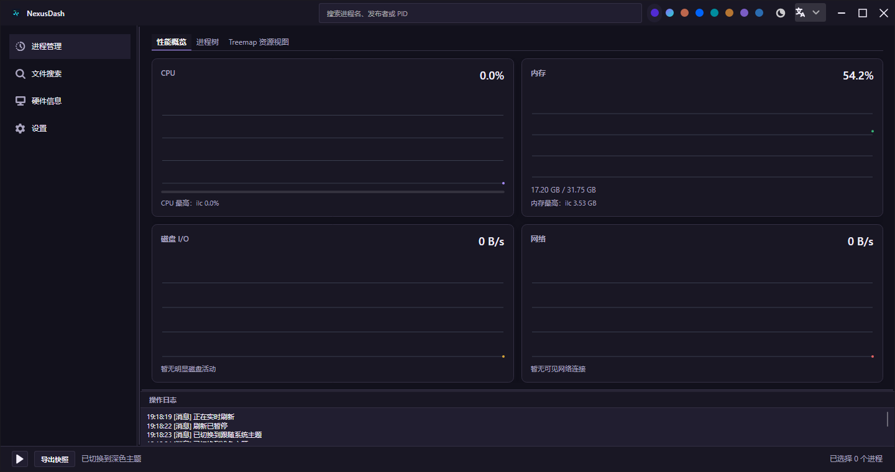
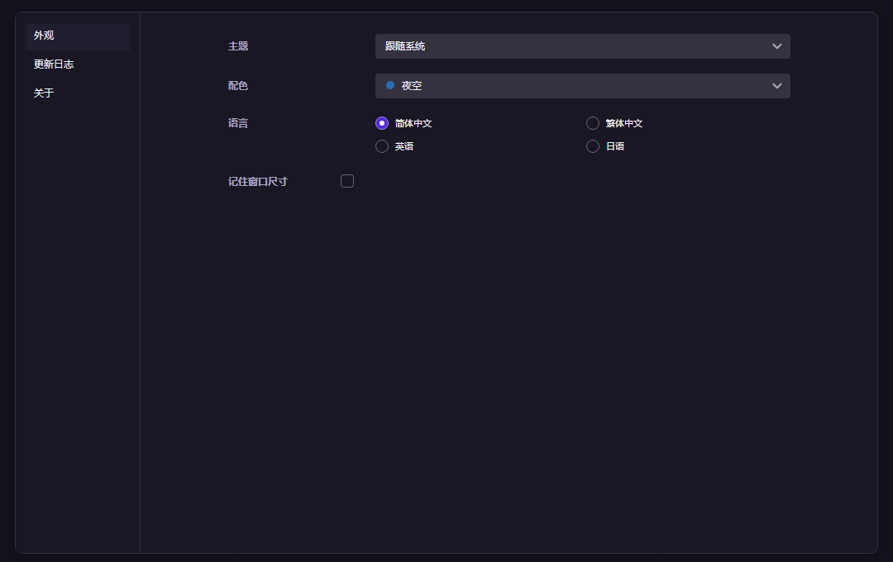
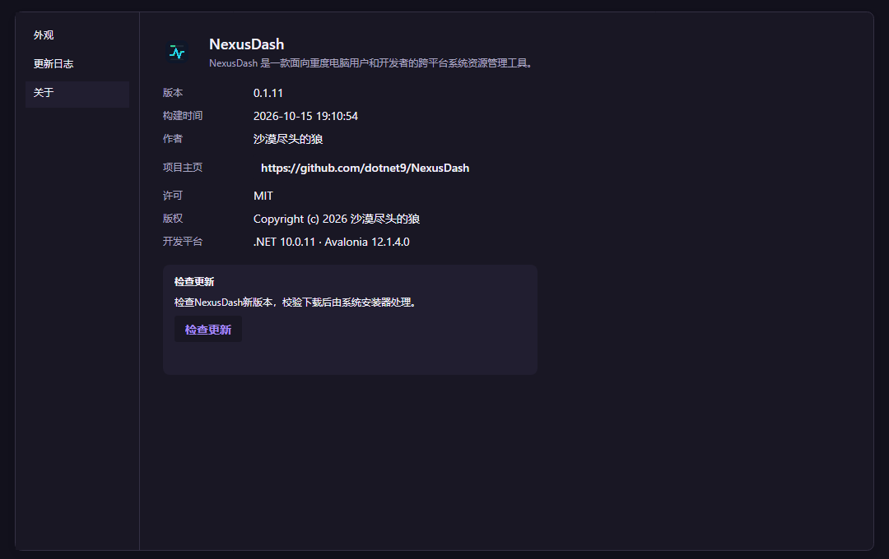

# 原型与 NativeAOT 复核

2026-10-15，版本 0.1.11。标题栏搜索右侧提供单排八色点、Ursa 三态模式按钮和四语下拉，复用外观设置页的主题与配色状态。

- 使用 CodeWF.Avalonia 12.1.4.22 和 Toolkit 1.0.0.19。宿主 JSON 输出至 `I18n/`，强类型键由 T4 生成；应用与库共用 Toolkit 语言单例，宿主资源优先覆盖库内嵌资源。
- 执行仓库 `scripts/publish.ps1 -RuntimeIdentifier win-x64` 发布正式 Windows NativeAOT；UI 验证器另行 NativeAOT 发布并运行，绘制真实 App 和设置窗口。八色三态采用 Ursa 内部按钮实际点击，验证当前提示随语言变化、偏好保存和四语下拉，检查 1180/1440 宽度无重叠。
- 原生验证覆盖 40px 标题栏、字体回退、八色浅深组合、旧配色迁移、已打开设置页的动态四语通知与选项刷新、关于页实际版本和编译时间。
- 更新状态机以受控服务验证检查、失败、缺校验文件、下载、校验失败、安装、重复检查、动态切语、取消和关闭期间取消；不启动真实安装器。
- 单文件离线原型覆盖四个导航入口、四语、八色三态、系统变化、进程搜索/筛选及更新状态，标题栏与桌面窗框同步实现。
- 本机生成 Windows EXE 安装器及 SHA256；包装回归检查 macOS Resources、Linux 桌面入口和图标、符号剔除、失败传播及五平台安装器资产门禁。

正式 EXE 另提供 `--verify-runtime <独立目录>` 自检：检查发布的语言 JSON、全局动态切语与隔离偏好持久化。Windows 下还会只读采样实际硬件、进程和系统指标，验证 CPU 名称、物理核、总内存、固件以及进程命令行、服务元数据，不输出用户进程名或路径。该检查不创建窗口、不读取用户账号或仓库；UI 验证器另行检查真实控件与布局，两者均不替代人工桌面验收。

Windows 硬件和进程静态信息复用现有隐藏命令执行器，通过系统 PowerShell CIM 查询并解析 JSON，移除 NativeAOT 下无法初始化的 `System.Management`。静态元数据保留缓存，高频基础采样继续使用原生接口；冷启动设置查询时限，取消或超时终止子进程树。验证需同时检查托管与正式原生产物的实际字段，页面和主题断言通过不代表系统遥测有效。

`design/index.html` 是当前单文件产品原型，按现有四张监控卡片和设置流程完善；历史概念稿保留在 `scripts/prototype/legacy.html`。截图使用真实系统只读采样，未执行结束进程等破坏性操作。

锁屏期间使用离屏渲染和无头浏览器。交互覆盖或局部几何不能视为全页 95% 还原。鼠标键盘、输入法、多 DPI、跨屏、真实安装器及其他操作系统 UI 尚需验收。第三方依赖保留裁剪与 AOT 分析警告，已通过路径不代表全部反射分支。
